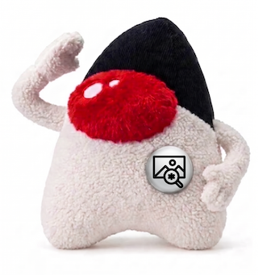

[](https://jitpack.io/#umjammer/vavi-image-steganography)
[](https://github.com/umjammer/vavi-image-steganography/actions/workflows/maven.yml)
[](https://github.com/umjammer/vavi-image-steganography/actions/workflows/codeql.yml)


# vavi-image-steganography



a modification-free steganography method based on image information entropy.

## Install

 * [maven](https://jitpack.io/#umjammer/vavi-image-steganography)

## Usage

```java
BufferedImage cover = ImageIO.read(...);
byte[] secret = "SymmetricKeyExchange".getBytes(StandardCharsets.UTF_8);

// Encode (modification-free: cover image pixels are not altered)
EntropySteganographyOp encodeOp = new EntropySteganographyOp(secret);
BufferedImage stego = encodeOp.filter(cover, null);
MappingKey key = encodeOp.getMappingKey();

// Decode from unmodified (or scaled/rotated) cover image and MappingKey
EntropySteganographyOp decodeOp = new EntropySteganographyOp(key);
decodeOp.filter(stego, null);
byte[] recovered = decodeOp.getSecret();
```

- [sample](src/test/java/vavi/image/steganography/TestCase.java)

## References

 * Shuang-Kui Xia and Jianbin Wu, "[A Modification-Free Steganography Method Based on Image Information Entropy](https://onlinelibrary.wiley.com/doi/10.1155/2018/6256872)", *Security and Communication Networks*, vol. 2018, Article ID 6256872, 2018.

## TODO

---

<sub>image designed by @umjammer, drawn by nano banana</sub>
